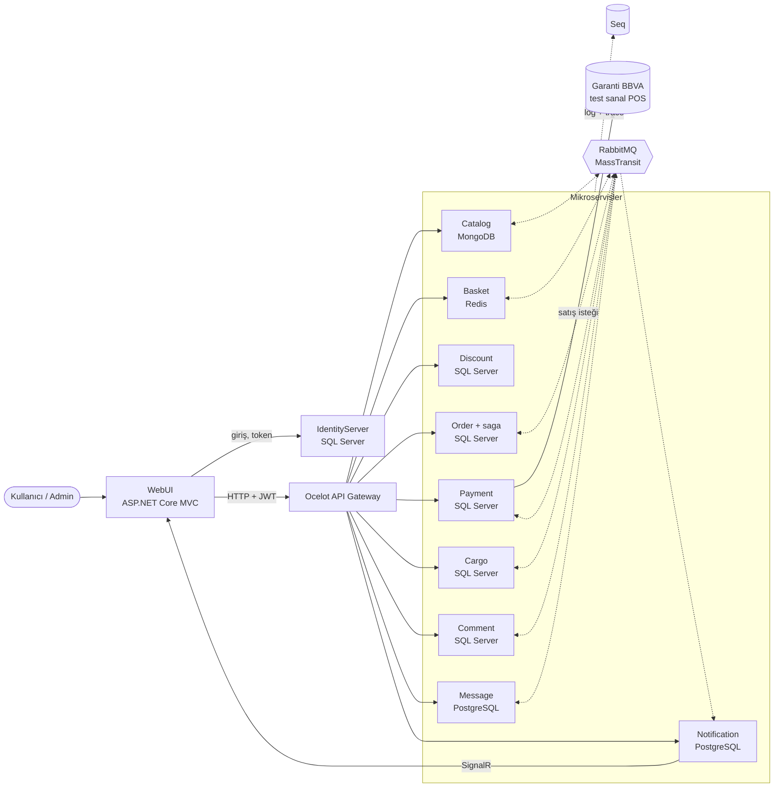
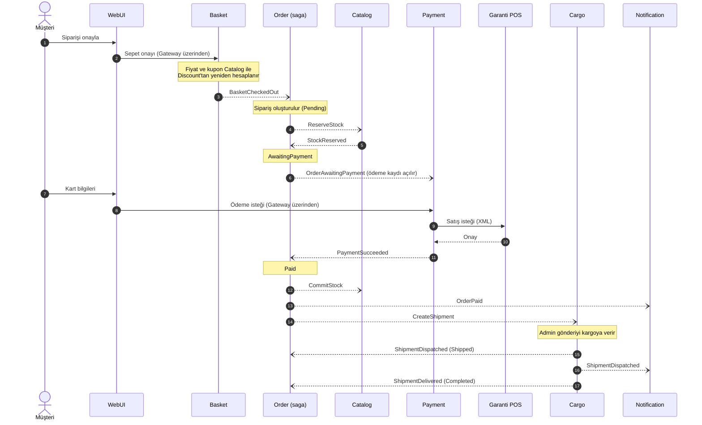

# MultiShop – Mikroservis Mimarili E-Ticaret

[](https://github.com/utkucakarr/multishop-microservices/actions/workflows/ci.yml)

MultiShop, .NET 8 ile mikroservis mimarisinde geliştirilmiş bir e-ticaret uygulamasıdır. Ziyaretçiler ürünleri inceleyip sepete ekleyebilir, kayıtlı kullanıcılar kupon kullanıp sipariş verebilir ve Garanti BBVA test sanal POS'u ile ödeme yapabilir. Siparişler kargoya verilip teslim edilene kadar takip edilir; kullanıcıya e-posta ve site içi bildirim gönderilir. Yönetim panelinden ürünler, yorumlar, kuponlar, kargolar ve mesajlar yönetilir.

Her servis kendi veritabanına sahiptir. Servisler arası iş akışları (sipariş, stok, ödeme, kargo, bildirim) RabbitMQ üzerinden MassTransit ile, olay tabanlı yürür. Sipariş süreci Order servisindeki bir saga ile yönetilir.

## İçindekiler

- [Mimari](#mimari)
- [Servisler](#servisler)
- [Sipariş akışı](#sipariş-akışı)
- [Teknolojiler](#teknolojiler)
- [Kurulum](#kurulum)
- [Loglar ve tracing](#loglar-ve-tracing)
- [Testler ve CI](#testler-ve-ci)
- [Bilinen sınırlar](#bilinen-sınırlar)
- [Görseller](#görseller)

## Mimari



- **WebUI** kullanıcının gördüğü MVC uygulamasıdır; servislere yalnızca **Ocelot Gateway** üzerinden, IdentityServer'dan aldığı JWT ile erişir.
- **Senkron çağrılar** (HTTP) yalnızca kullanıcıya hemen cevap gereken yerlerde kullanılır: ör. sepet onayında Basket, fiyatı Catalog'dan ve kuponu Discount'tan yeniden hesaplar.
- **Asenkron mesajlar** (RabbitMQ) servisleri birbirine bağımlı kılmadan iş akışını yürütür. Mesaj yayınlayan servisler **transactional outbox** kullanır (EF Core ya da MongoDB): veritabanı değişikliği ile mesaj ya birlikte kaydedilir ya hiç kaydedilmez. Redis'te transaction olmadığı için Basket bu kuralın dışındadır; RabbitMQ'ya ulaşamazsa sepet onayı hata döner.
- Tüm servisler loglarını ve **OpenTelemetry** trace'lerini **Seq**'e gönderir; bir isteğin servisler ve kuyruklar arasındaki yolu tek bir trace olarak izlenebilir.

## Servisler

| Servis | Adres | Veritabanı | Sorumluluk |
|--------|-------|------------|------------|
| WebUI | https://localhost:7052 | – | Müşteri sitesi ve yönetim paneli (MVC) |
| IdentityServer | http://localhost:5010 | SQL Server | Kullanıcılar, roller, giriş ve token (IdentityServer4 + ASP.NET Identity) |
| Ocelot Gateway | http://localhost:5020 | – | Tek giriş noktası, token doğrulama, yönetim paneli için istatistik birleştirme |
| Catalog | http://localhost:7070 | MongoDB | Ürün, kategori, marka, görseller, stok rezervasyonu |
| Basket | http://localhost:7074 | Redis | Sepet, fiyat ve kupon hesabı, sepet onayı |
| Discount | http://localhost:7071 | SQL Server (Dapper + EF Core migration) | Kupon kodları |
| Order | http://localhost:7072 | SQL Server | Siparişler, adresler, sipariş saga'sı (Onion mimari, CQRS + MediatR) |
| Payment | http://localhost:7076 | SQL Server | Ödeme kayıtları, Garanti BBVA sanal POS entegrasyonu |
| Cargo | http://localhost:7073 | SQL Server | Kargo şirketleri, gönderiler (N-Tier mimari) |
| Comment | http://localhost:7075 | SQL Server | Ürün yorumları ve moderasyon |
| Message | http://localhost:7078 | PostgreSQL | İletişim formu mesajları |
| Notification | http://localhost:7079 | PostgreSQL | E-posta (MailKit) ve site içi (SignalR) bildirimler, bildirim tercihleri |

Altyapı (SQL Server, MongoDB, PostgreSQL, Redis, RabbitMQ, Seq) `docker-compose.yml` ile çalışır; port ve bağlantı bilgileri [scripts/dev-infra/README.md](scripts/dev-infra/README.md) içindedir.

## Sipariş akışı



Hata durumları da saga tarafından yönetilir:

- **Stok yetersiz** → `StockReservationFailed`: sipariş iptal edilir.
- **Ödeme reddedildi** → `PaymentFailed`: müşteri aynı sipariş için tekrar deneyebilir; 3. başarısız denemede sipariş iptal edilir ve ayrılan stok `ReleaseStock` ile geri bırakılır.
- **Sipariş iptali** → `OrderCancelled` yayınlanır; Payment bekleyen ödeme kaydını kapatır.
- Aynı mesajın tekrar gelmesi (ör. ikinci sepet onayı ya da geç gelen `StockReserved`) siparişi bozmaz; saga her durumda hangi mesaja nasıl cevap vereceğini bilir.

## Teknolojiler

**Backend**
- .NET 8, ASP.NET Core Web API ve MVC
- IdentityServer4, ASP.NET Core Identity, JWT / OAuth 2.0
- Ocelot API Gateway
- MassTransit 8 + RabbitMQ (saga, transactional outbox)
- Entity Framework Core 8, Dapper
- MediatR (CQRS), FluentValidation, AutoMapper
- SignalR, MailKit
- Garanti BBVA sanal POS (test ortamı)
- Yerel disk ya da Google Cloud Storage (ürün görselleri)

**Veritabanları:** SQL Server 2022, MongoDB 8, PostgreSQL 17, Redis 7

**Gözlemlenebilirlik:** Serilog, Seq, OpenTelemetry (tracing)

**Test ve CI:** xUnit, AwesomeAssertions, NSubstitute, MassTransit test harness, Testcontainers, GitHub Actions

**Frontend:** Razor (MVC), HTML, CSS, JavaScript, Bootstrap

**Mimari yaklaşımlar:** mikroservisler, database-per-service, olay tabanlı iletişim, saga (orchestration), transactional outbox, API Gateway, Onion mimari (Order), N-Tier (Cargo), CQRS + Mediator

## Kurulum

**Gerekenler:** .NET 8 SDK, Docker Desktop, Visual Studio 2022, PowerShell

```powershell
# 1) Şifre dosyası: .env.example'ı kopyalayıp içindeki şifreleri değiştirin
Copy-Item .env.example .env

# 2) Altyapıyı başlatın ve container'ların "healthy" olmasını bekleyin
docker compose up -d
docker compose ps

# 3) Tüm projelerin bağlantı dizelerini user-secrets'a yazın
.\scripts\dev-infra\set-dev-secrets.ps1

# 4) IdentityServer client secret'larını üretin ve admin hesabını oluşturun
.\scripts\dev-infra\set-identity-secrets.ps1 -AdminEmail <e-posta> -CreateAdmin

# 5) Veritabanı şemalarını oluşturun
.\scripts\dev-infra\apply-migrations.ps1
```

Ödeme ve e-posta için şu ayarlar ilgili projenin user-secrets'ına ayrıca girilir:

- **Payment:** `GarantiPosSettings` (TerminalId, MerchantId, ProvisionPassword; Garanti BBVA test ortamı bilgileri)
- **Notification:** `SmtpSettings`

Ardından Visual Studio'da çözüme sağ tıklayıp **Configure Startup Projects → Multiple startup projects** ile WebUI, IdentityServer, Gateway ve tüm servisleri **Start** olarak işaretleyin ve çalıştırın. Site: https://localhost:7052

Script'lerin ayrıntıları ve sık karşılaşılan sorunlar: [scripts/dev-infra/README.md](scripts/dev-infra/README.md)

## Loglar ve tracing

Seq arayüzü: http://localhost:8091

- **Loglar:** Her log kaydında `Application` alanı vardır; ör. `Application = 'Order'` ile yalnızca Order servisinin logları görülür.
- **Trace'ler:** HTTP istekleri, servisler arası HTTP çağrıları ve MassTransit mesajları OpenTelemetry ile izlenir. Trace bağlamı RabbitMQ mesajlarının başlığında taşındığı için bir siparişin WebUI → Gateway → Basket → Order → Catalog → Payment → … yolu tek bir trace altında görünür. Bir log kaydındaki TraceId'ye tıklayarak o isteğin tüm span'lerine ve loglarına ulaşılabilir.
- **Hata yanıtları:** Servisler hataları `ProblemDetails` olarak döner; yanıttaki `traceId` Seq'te aratılarak hatanın oluştuğu istek bulunur.

## Testler ve CI

| Proje | Tür | Kapsam |
|-------|-----|--------|
| `MultiShop.Basket.UnitTests` | Birim | Sepet fiyat ve kupon hesabı |
| `MultiShop.Catalog.UnitTests` | Birim | Ürün ve stok domain kuralları |
| `MultiShop.Order.UnitTests` | Birim | Sipariş saga'sı (MassTransit test harness), adres doğrulama |
| `MultiShop.Catalog.IntegrationTests` | Entegrasyon | Catalog API ve stok mesajları, gerçek MongoDB ile (Testcontainers) |
| `MultiShop.Payment.IntegrationTests` | Entegrasyon | Ödeme kaydı kuralları (tek deneme, deneme hakkı, iptal, belirsiz banka hatası), gerçek SQL Server ile (Testcontainers) |

```powershell
dotnet test MultiShop.sln
```

Entegrasyon testleri için Docker çalışıyor olmalıdır. GitHub Actions her push'ta ve `dev`/`main` dallarına açılan PR'larda çözümü derleyip tüm testleri çalıştırır ([ci.yml](.github/workflows/ci.yml)).

## Bilinen sınırlar

- **İade yok:** Ödemesi alınmış bir sipariş iptal edilirse para iadesi otomatik yapılmaz.
- **Banka zaman aşımı:** Bankadan cevap alınamazsa ödemenin sonucu belirsiz kalır; işlem tekrar denenmeden önce banka tarafında kontrol edilmelidir.
- **Ödeme kaydı gecikmesi:** Ödeme kaydı `OrderAwaitingPayment` mesajıyla oluşturulduğu için sipariş açıldıktan sonra yaklaşık bir saniye boyunca Payment servisi siparişi bulamayabilir.
- Uygulama geliştirme ortamı için yapılandırılmıştır; servisler Docker ile yayına alınmaya hazır değildir.

## Görseller


